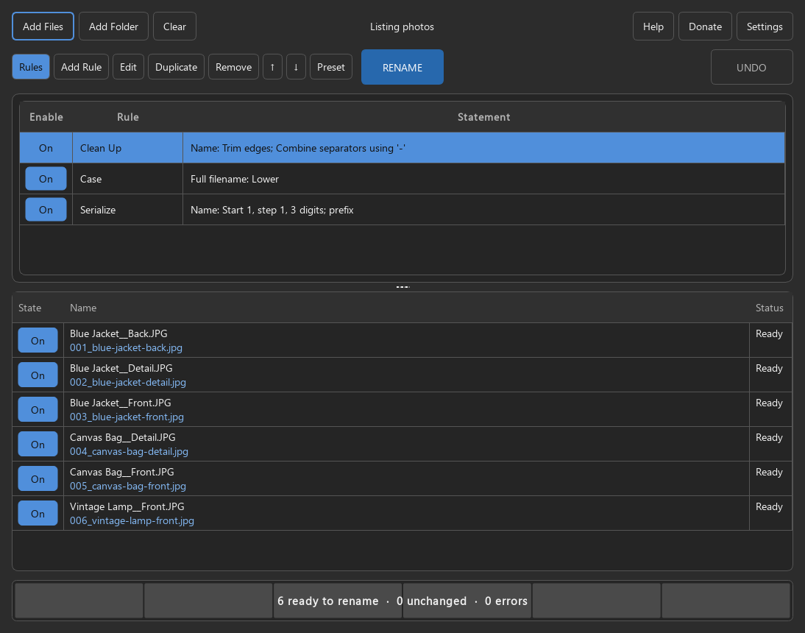

# File Renamer

**Preview every filename. Rename a batch. Undo when needed.**

Rename photo batches, downloads and documents without editing each filename by hand.
For example, add a prefix to turn `photo_01.jpg` into `listing_photo_01.jpg`, review the
whole batch, then rename it. Undo restores the last batch, including after a restart.

**Free for Windows and Linux.** All features work offline. No account, upload,
subscription or telemetry. Optional donations never unlock features.

[Windows and Linux downloads](https://github.com/steadystatestudio/file-renamer-releases/releases)
· [Report a problem](https://github.com/steadystatestudio/file-renamer-releases/issues)
· [Donate on Ko-fi](https://ko-fi.com/steadystatestudio)

Choose the Windows ZIP or Linux AppImage listed in the release notes. The large
Qt/PySide source archives are for developers and license compliance, not installation.
Packages are unsigned; verify the published checksum and follow your normal security policy.



## Run

[App details](https://steady-state-studio.steadystatestudio1.workers.dev/apps/file-renamer/) ·
[Release downloads and checksums](https://github.com/steadystatestudio/file-renamer-releases/releases) ·
[Report a problem](https://github.com/steadystatestudio/file-renamer-releases/issues)

### Portable Windows build

Extract `File-Renamer-windows.zip` and run `File-Renamer/File-Renamer.exe`.
Keep the `_internal` folder beside the executable. Python is bundled.

### Linux

Use a natively built `File-Renamer-x86_64.AppImage`:

```sh
chmod +x File-Renamer-x86_64.AppImage
./File-Renamer-x86_64.AppImage
```

If FUSE is unavailable, use `APPIMAGE_EXTRACT_AND_RUN=1 ./File-Renamer-x86_64.AppImage`.
The Linux build targets contemporary x86-64 distributions with glibc 2.35+.
To update, close the app and replace the existing `File-Renamer-x86_64.AppImage` with the new download.
Settings, presets, and rename history use fixed user storage paths shared across versions,
regardless of the AppImage filename.

The local AppImage has been verified on Ubuntu 22.04 under WSL 2, including X11 GUI checks.
See [Linux build instructions](docs/LINUX_BUILD.md) to use the dedicated WSL builder or build natively.
AppImage generation and Linux checks can also run in the included GitHub Actions workflow.

### From source

Requires Python 3.11+ and Windows or Linux.

```sh
python -m venv .venv
# Windows: .venv\Scripts\activate
# Linux: source .venv/bin/activate
python -m pip install -c packaging/build-constraints.txt -e ".[dev,packaging]"
python scripts/build_rule_tools.py
python -m file_renamer
```

## Workflow

1. **Add Files**, **Add Folder**, or drag files/folders onto the window.
2. **Add Rule** and configure its options. Rules run from top to bottom.
3. Inspect **Original name → New name**. Wrapped names and horizontal scrolling reveal
   long filenames; the Status column displays errors. Red rows must be fixed or excluded.
4. Click **RENAME**. Filenames change exactly as previewed; contents stay intact.
5. **Undo Last Rename** restores the latest batch, including after restarting the app.

After renaming, the app pauses the preview so insertion/numbering rules do not
immediately suggest another pass. Change a rule or press **F5** to begin another preview.

Right-click the table to include, exclude, or remove selected files. Click column
headings to sort. Numbering follows the displayed order of included files.
Folder scans include only immediate files by default; enable subfolder scanning
in Settings. Symbolic links and Windows junctions are skipped. Dotfiles, dotfolders, and files inside
hidden folders are excluded, including direct selections. Windows Hidden/System attributes
are also respected. The collection summary reports hidden exclusions. Directories
themselves are never renamed, and files stay in their original folders.

### Rules

| Rule | Options |
|---|---|
| Insert | Text/metadata; prefix, suffix, position from either end, replace, before/after |
| Delete | Position or delimiter; count, end delimiter or end; right-to-left; retain delimiters |
| Remove / Replace | First/last/all, case sensitivity, whole words, wildcards, multiple entries |
| Rearrange | Delimiter sets, exact delimiters or positions; `$1`, `$-1`, `$0`; metadata |
| Extension | Replace, append, remove duplicates or detect a binary signature |
| Strip | Letters, digits, symbols, brackets, custom characters and Unicode ranges; invert, leading/trailing |
| Case | Title, first, sentence, upper/lower/swap; preserve case, forced fragments, extension case |
| Serialize | Start, step, repeat, resets, padding, seven numbering systems and insertion locations |
| Randomize | Selected character sets, length, uniqueness and insertion location |
| Padding | Add/remove numeric zeros and left/right text padding |
| Clean Up | Bracket contents, separators, spaces, marks, emoji, capitals and SharePoint preparation |
| Translit | Editable alphabets, load/save/clipboard, forward/backward and automatic case |
| Reformat Date | Multiple formats, custom month names, whole words and date/time adjustments |
| Regular Expressions | Native Unicode TRegExpr patterns and `$1` substitutions |
| Pascal Script | Real PascalScript compiler; completion, examples, compile checks, read-only helpers |
| User Input | One new name per included file; prefix, suffix or replacement |
| Mapping | Editable match/name table; partial, inverse, case-sensitive and reusable matches |
| Repair filename | This computer or Windows-compatible; applies to the full filename |

The picker contains all 18 ReNamer rule families, with Repair filename appended.
New rules use one-based positions and a **Skip extension** option where applicable.
`archive.tar.gz` has the final extension `gz`.

Version-1 presets retain their original options, zero-based positions, Python regex
syntax, and Latin accent removal. Their editors show **Legacy**. Version-2 backups
record behavior per rule, so old and new rules can coexist without changing saved jobs.

New regex example: pattern `^(.*)_(\d+)$`, replacement `$2_$1` changes
`photo_42.jpg` to `42_photo.jpg` with the extension protected. Use `\g<0>` for the
whole match (use `$0` for new rules). Literal text replacement does not interpret
backslashes. Native regex and Pascal executions have five-second deadlines.
Metadata previews have a two-minute batch deadline. Random names are frozen in
the preview and Rename uses those exact names.

**Insert meta tag** exposes the 140-tag catalog. File information, hashes, email,
HTML, torrent and Android data use read-only adapters; image, audio, document,
font and executable metadata use bundled ExifTool. Absent fields are empty;
extraction failures become preview errors. DOS paths and creation timestamps
depend on platform/filesystem support. Pascal file reads are limited to 1 MiB.
Scripts cannot write files, import DLLs, launch programs or open dialogs.
See [compatibility details](docs/RENAMER_COMPARISON.md).

Named presets store the ordered rules. Use **Presets → Load Preset** in the Rules control cluster
to load a preset. The **Presets** menu also contains **Save Preset**, **Import Preset**,
**Export Preset**, and deletion. **Export Preset** saves the
current rules (including unsaved changes) as editable TOML or JSON. Save As starts in your
Documents folder, or your home folder if Documents is unavailable. **Import Preset**
validates a backup before loading it; duplicate names receive a numbered suffix. Existing
JSON backups remain supported. See [editable preset examples](docs/PRESETS.md).

Rules sit above Files. Drag the gripper between them to resize the panel, or click **Rules**
to show or hide the rule list. The control rows stay in place: file and help controls
above, and a single row with Rules and rule actions at the left, **RENAME** centered
across the window, and **UNDO** at the far right.
The minimum width stops horizontal resizing before action buttons overlap, keeping every
button visible with its full label, including on smaller screens. RENAME turns blue when files
are loaded; it becomes clickable only when a
valid preview has changes. Hover over it for the reason when it is unavailable.
The Add/Edit Rule dialog fits the longest rule label and the complete list when screen height
permits. The editor uses compact ReNamer-style groups, visible radio choices, checkboxes,
and readable 12-point text. Position and delimiter fields sit beside their choices. Dialogs
fit the selected rule and expand when options need more room; choices reflow on small screens.
Vertical scrolling appears only when content exceeds the available screen height. Neither
rule area scrolls horizontally.

Resize or maximize the window; its size, screen position, maximized state, and Rules panel
state are remembered. Each file has a centered **State** button and stacked **Original** / **New**
names that share the same left edge and wrap to the available width. The original is above
the proposed name, with no labels interrupting the comparison. A blue **On** button
includes the file; an outlined **Off** button excludes it. Click the button or press Space in its
cell to toggle inclusion. Rule enablement uses the same buttons; boolean options in rule editors
use compact checkboxes. Settings retains its labeled toggle button. **Status** follows; full folder paths remain
available in tooltips.
Status fits its longest currently displayed word with compact padding; multiword statuses
and complete error messages wrap. Right-click a
file-column heading to sort by either name, show/hide columns, or reset widths; Name stays visible.
Name fills available space; other file-column widths and visibility are remembered.
Rules use width-fitted **Enable** and **Rule** columns plus a stretching, wrapped **Statement** column.
Both tables have grid lines; only the Files table can be sorted.

The rounded progress bar follows Padder’s styling and centers the preview summary, operation
counts, or error message in a single line. Hover for the full text of long messages.
It shows one unfilled segment per file being changed as soon as the preview
is ready. Pending previews and empty batches show a plain idle bar. Preparation shows counts without
filling segments; completed filenames fill their segments and advance the percentage.
Very large batches group segments visually while retaining exact counts. The completed result
stays visible until the next operation.
There is no main-window Cancel button; wait for an operation to finish before closing.

Invalid filenames are blocked in preview. Add **Repair filename** when you want explicit
cleanup; every repair appears in the preview. Linux permits backslashes, colons, and other
characters Windows prohibits. This computer follows the running OS; Windows-compatible
uses Windows naming restrictions on both platforms. Neither mode truncates long names or
resolves collisions automatically. Filesystem limits still apply. Ordinary text rules produce
the same results on both platforms for the same names and numbering order.

Current rules, selected preset, theme, scan preference, and last folder are remembered.
The selected preset returns in the top label and appears first in the Load menu.
Unsaved rule changes retain the preset name with `(modified)`.

### Keyboard

| Shortcut | Action |
|---|---|
| Ctrl+O | Add files |
| F5 | Refresh preview |
| F6 | Rename previewed files |
| Ctrl+Shift+Z | Undo / recover last rename |
| Tab / Shift+Tab | Move between controls |
| Space | Toggle the focused inclusion or option button |

## Safety and recovery

- Preview never renames files. It checks source identity, destination collisions,
  names, and filename length. Execution checks again before it starts.
- Native no-replace moves prevent destination overwrites: Windows rename and
  Linux `renameat2(RENAME_NOREPLACE)`. Unsupported Linux filesystems fail safely.
- Files first move to unique temporary names in the same folder, allowing swaps,
  cycles, and case-only changes without replacing other files.
- A durable snapshot plus append-only event log records each move's intent and
  completion. A failure stops the batch and attempts rollback.
- An interrupted batch exposes **RECOVER** on restart. Missing, edited,
  or replaced files and occupied original names stop recovery; resolve the stated
  problem and retry. The result dialog lists unresolved paths and the journal location.
- The most recent batch is undoable. Starting another batch replaces that history.
  Keep `last-rename.json` **and** `last-rename.log` together until recovery is complete.
- A process lock prevents two GUI instances from sharing the same journal.

This is a sequence of filesystem operations, not a filesystem-wide atomic transaction.
External changes and storage failures can require recovery. Avoid editing or moving
the files while a batch is running. Identity checks use device/inode, size, and
modification time; they are not cryptographic content checks. Windows collision
checks are conservatively case-insensitive, even in case-sensitive directories.
Linux case-folding flags are detected where supported; the native no-replace call
is the final authority on collisions. Network filesystems must support that operation.

Preferences use Qt's user INI settings location. Presets and journals use
`QStandardPaths.AppLocalDataLocation` (typically `%LOCALAPPDATA%/Steady State Studio/File Renamer`
on Windows or `~/.local/share/Steady State Studio/File Renamer` on Linux).
There are no accounts, uploads, telemetry, or automatic update requests.

## Development and packaging

```sh
python -m ruff check src tests scripts
python -m pytest -q
python scripts/render_preview.py
python scripts/build.py
```

Build on the target OS. Windows produces a portable ZIP. Linux downloads verified
[appimagetool](https://github.com/AppImage/appimagetool) 1.9.1 and type2 runtime
20251108. An `APPIMAGETOOL` override must match the same checksum. The workflow verifies the packaging inputs, builds
both platforms, tests packaged preview workers and the real GUI rename/Undo workflow.
It does not publish releases. Windows binaries are unsigned. Verify checksums and follow your normal security
policy; do not disable protection to run this app.

Testing builds also produce a Linux `File-Renamer-linux-x86_64.tar.gz` portable
bundle. Extract it and run `File-Renamer/File-Renamer` when AppImage/FUSE is
unavailable. `dist/BUILD-INFO.json` records the source commit, tree and installed
dependency versions; `dist/SHA256SUMS` identifies the exact testing archives.
The manually dispatched candidate workflow retains passing packages, checksums, synthetic
screenshots, JUnit results and matching library sources in a draft release.
It never publishes; see [release preparation](docs/RELEASE-CANDIDATE.md).

Native tools are compiled/staged by `scripts/build_rule_tools.py`. Windows uses
a checksum-pinned portable Free Pascal compiler when none is installed. Linux
requires Free Pascal, FCL units, development linking files and Perl;
`scripts/setup_linux_build.sh` installs them in the dedicated builder. Dependency
downloads occur during building; packaged apps run offline.

Architecture: pure rule transformations → immutable preview plan → validating,
journaled executor. Qt uses a model-backed table, background scanning/execution,
and a disposable subprocess for previews. Internal presets and journals are versioned JSON; backups also support TOML.
Tests cover transformations, actual filesystem operations, conflicts, recovery,
undo, UI workflows, a pathological regex, and a 10,000-file preview.
See [validation results](docs/VALIDATION.md) for measured performance and platform verification status.

Directory renaming, moving files, command-line batch automation and importing
ReNamer's own preset files remain outside this app's scope.

## Support

File Renamer is free and open source. If it saves you time, you can
[buy me a coffee on Ko-fi](https://ko-fi.com/steadystatestudio) — entirely optional,
always appreciated. The **Donate** button in the app opens the same page in your browser.

## License

[MIT](LICENSE), Copyright (c) 2026 Steady State Studio.
See [third-party notices](THIRD_PARTY_NOTICES.md) for bundled dependencies.
