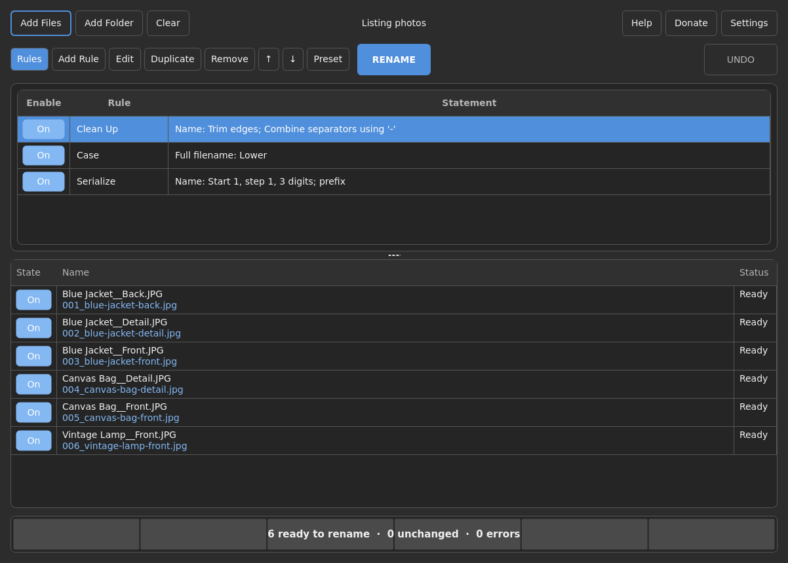

# Linux build

## Run the application

Copy `dist/File-Renamer-x86_64.AppImage` to an x86-64 Linux machine with glibc 2.35 or newer:

```sh
chmod +x File-Renamer-x86_64.AppImage
./File-Renamer-x86_64.AppImage
```

Python, Qt, the Pascal runtime, ExifTool and Perl are bundled. If the host cannot mount AppImages through FUSE:

```sh
APPIMAGE_EXTRACT_AND_RUN=1 ./File-Renamer-x86_64.AppImage
```

To check the downloaded file, put the companion `.sha256` file in the same directory and run:

```sh
sha256sum -c File-Renamer-x86_64.AppImage.sha256
```

The artifact was built and tested on Ubuntu 22.04.5 under WSL 2. See [validation](VALIDATION.md).



## Rebuild from this Windows workspace

A dedicated WSL 2 distribution named **File-Renamer-Build** is installed. Its virtual disk is kept
under `C:\dev\file_renamer\.wsl\File-Renamer-Build`, outside the disposable `build` directory.
The actual source staging, Python environment, and build outputs are on its ext4 filesystem at
`/opt/file-renamer/work`. The Windows Python environment and Windows executable are separate.

From PowerShell:

```powershell
wsl -d File-Renamer-Build -u root --exec bash /mnt/c/dev/file_renamer/scripts/build_linux_wsl.sh
```

This synchronizes the source into the dedicated Linux working directory, installs the constrained
build dependencies, runs tests, renders screenshots, builds the AppImage, and checks both its
headless and X11 launch paths. It exports the AppImage and checksum to the Windows `dist` folder
and the test report, build versions, and screenshots to `artifacts/linux`.

The distribution is a disposable build environment and runs its build commands as root. The
application itself does not need root privileges on the destination desktop. Do not manually
delete or move its virtual disk; use WSL's distribution management commands if it is no longer needed.

## Build on an existing Ubuntu 22.04 machine

Install Python 3.11+ (the validated build uses 3.12), then run from the repository root:

```sh
sudo bash scripts/setup_linux_build.sh --system-only
python3.12 -m venv .venv
source .venv/bin/activate
python -m pip install -c packaging/build-constraints.txt '.[dev,packaging]'
QT_QPA_PLATFORM=offscreen python -m pytest -q
python scripts/fetch_appimagetool.py
APPIMAGETOOL="$PWD/build/tools/appimagetool" python scripts/build.py
python scripts/smoke_bundle.py dist/File-Renamer-x86_64.AppImage
FILE_RENAMER_SMOKE_PLATFORM=xcb APPIMAGE_EXTRACT_AND_RUN=1 \
  xvfb-run -a python scripts/smoke_bundle.py dist/File-Renamer-x86_64.AppImage
```

`fetch_appimagetool.py` checks the downloaded packaging binary against its recorded SHA-256.
If the upstream continuous asset changes, review the new upstream artifact before updating the pin.
The build uses clean PyInstaller analysis so newly installed native libraries are collected.

The GitHub Actions workflow defines the same native dependencies and smoke checks, and uploads
build artifacts without publishing a public release.
